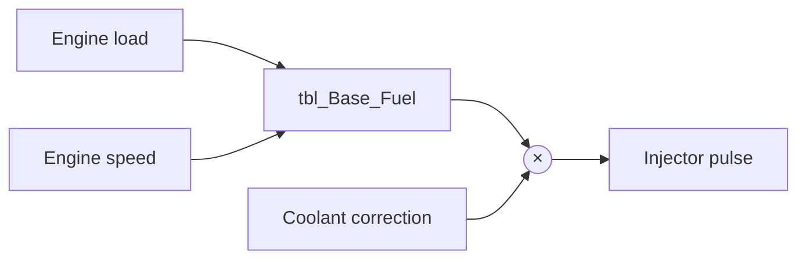

# Fuel

A made-up page for the documentation panel's example.

## Base fuel

The injector pulse starts from `tbl_Base_Fuel` by engine load and speed, then the corrections are applied.
At idle the [idle controller](idle.md#control-loop) keeps the speed; the fuel table is the same.

## Fuel pump

`tbl_Fuel_Pump_Duty` sets the pump duty by injector duty. This section has no figure.
