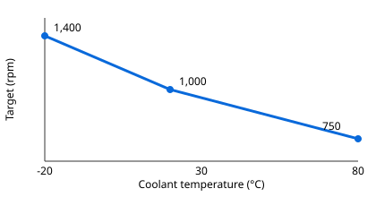
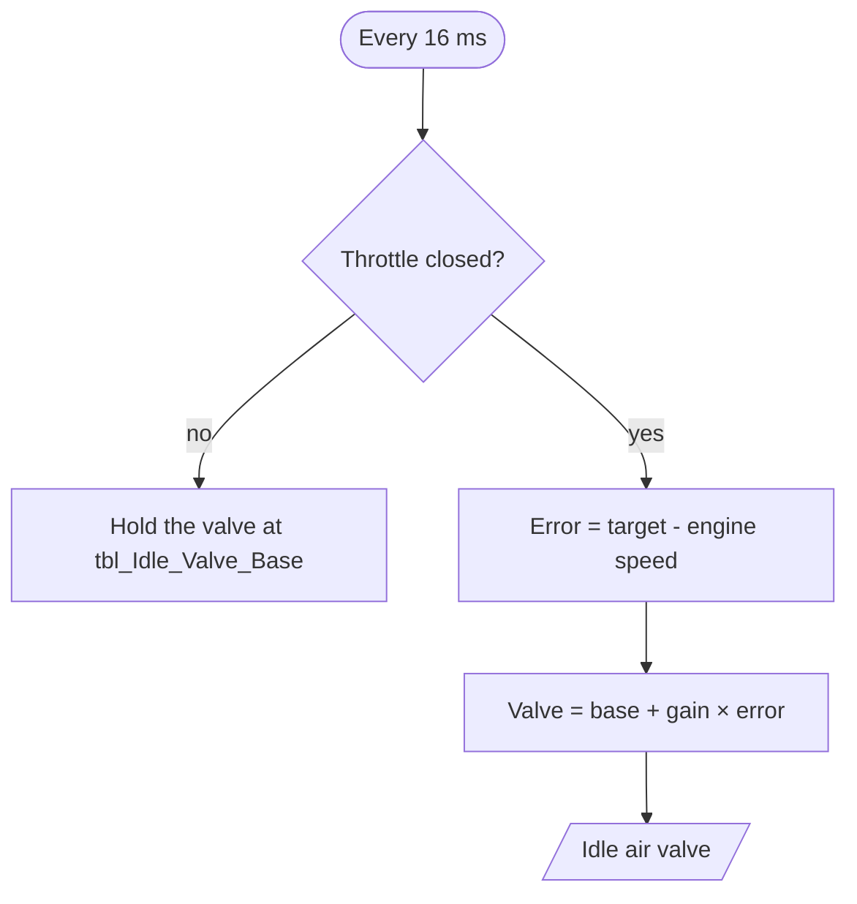
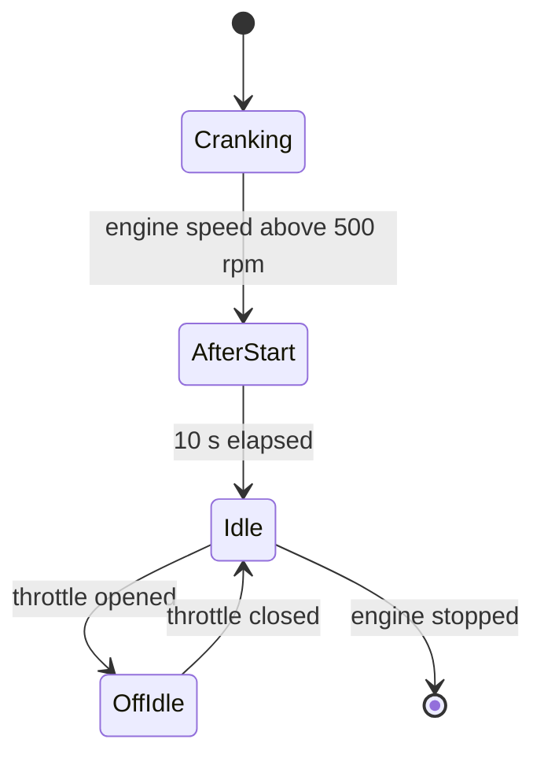

# Idle speed control

This is a made-up page that shows what the documentation panel can display. The engine and its tables are
invented; the names match the example index ([table_docs.xml](../table_docs.xml)).

The idle controller holds the engine speed at `tbl_Idle_Target`. Fuel during idle is covered on the
[fuel page](fuel.md#base-fuel).

## Target speed

The target comes from the coolant temperature:

| Coolant (°C) | Target (rpm) | Note |
| ---: | ---: | --- |
| -20 | 1,400 | cold start |
| 20 | 1,000 | |
| 80 | 750 | warm |



## Control loop



The gain is `tbl_Idle_Gain`; the base position is `tbl_Idle_Valve_Base`.

## States



In `AfterStart` the target is raised by `tbl_Idle_After_Start_Increase`.

## Code example

```c
valve = base + gain * (target - rpm);
```

See also: [the project page](https://github.com/RomRaider/RomRaider).
